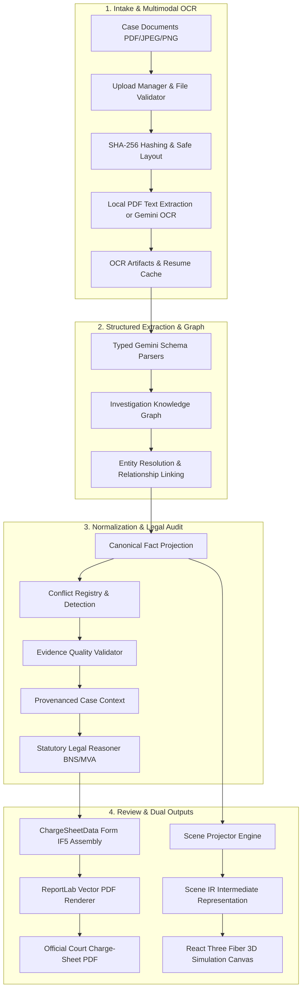

<div align="center">

# ⚖️ BYOMKESH AI (ब्योमकेश)
### Autonomous Provenance-Preserving Crime Investigation, Forensic Scene Reconstruction & Charge-Sheet Generation Engine

[](https://opensource.org/licenses/MIT)
[](https://python.org)
[](https://fastapi.tiangolo.com)
[](https://react.dev)
[](https://threejs.org)
[](https://ai.google.dev)
[](#)

*An investigative decision-support prototype for Investigating Officers (IOs), forensic examiners, and legal review teams.*

[Overview](#-overview) •
[System Architecture](#-system-architecture) •
[Core Features](#-core-features) •
[3D Forensic Simulation](#-3d-forensic-simulation-sentinel-hud) •
[Pipeline Stages](#-nine-stage-investigation-pipeline) •
[Quickstart Guide](#-quickstart-guide) •
[API Reference](#-api-reference) •
[Repository Layout](#-repository-layout)

---

</div>

## 📌 Overview

Under the modern Indian criminal justice system (**Bharatiya Nyaya Sanhita 2023 (BNS)**, **Bharatiya Nagarik Suraksha Sanhita 2023 (BNSS)**, and **Bharatiya Sakshya Adhiniyam 2023 (BSA)**), investigating agencies face unprecedented challenges:

- **Massive Documentation Burden:** Investigating Officers manually cross-reference 15+ complex documents per case (FIRs, Spot Panchnamas, Seizure Memos, Medico-Legal Cases (MLCs), Postmortem Autopsies, FSL ballistic/chemical reports, and witness depositions).
- **Provenance Vulnerability:** A single unsourced claim or mismatched timestamp in a Form IF5 Charge-Sheet can lead to evidentiary exclusion or acquittal.
- **Cognitive Scene Reconstruction Gap:** Reconstructing collision angles, braking trajectories, bullet vectors, and conflicting eyewitness testimonies from flat 2D site plans and panchnamas is error-prone.

**BYOMKESH AI** combines two areas of functionality:
1. **Document processing and review:** Ingests case documents, performs digital PDF text extraction or Gemini OCR, parses documents into typed Pydantic models, builds an investigation graph, detects factual conflicts, validates evidence support, produces constrained legal findings, and drafts a Form IF5-style charge sheet and PDF for human review.
2. **3D scene viewer:** Provides interactive, bundled example scenes with timeline controls, hypothesis toggles, and trajectory visualization. A backend scene projection module also produces scene data, but the current frontend viewer uses its bundled scenarios rather than loading that projection from the case API.

---

## 🏛 System Architecture



---

## ✨ Core Features

### 1. 🛡️ Provenance and Source Tracking
The pipeline carries document identifiers, SHA-256 checksums, page references, excerpts, and available confidence information through extracted facts and review artifacts. It supports traceability for human review; it does not establish a legally verified chain of custody or guarantee that every generated field has a source citation.

### 2. 🔍 Statutory Legal Reasoning Engine
- Version-pinned local BNS reference dataset and rule-based findings; Motor Vehicles Act references are used where configured by the case rules.
- Maps evidence items to explicit statutory crime ingredients (e.g. rashness/negligence under BNS 281 vs. mens rea under BNS 103).
- Findings are constrained to configured legal references and mapped case evidence, with unsupported or conflicting elements marked for review.

### 3. ⚖️ Human-in-the-Loop Review Lifecycle
- Tracks `DRAFT`, `REVIEW_REQUIRED`, `APPROVED`, `REJECTED`, and `FINALIZED` states.
- Reviewers can apply field-level corrections, add notes, record decisions, and inspect revision history. Approval and finalization are guarded by validation and review state; this is an application audit trail, not a statutory digital signature.

### 4. 🧠 Hybrid RAG Subsystem
- Case-isolated passage retrieval with embeddings when configured; a deterministic no-op embedding provider is used otherwise. Chunks preserve source and page references.

---

## 🎮 3D Forensic Simulation ("Sentinel" HUD)

The frontend viewer (`frontend/src/simulation/`) renders three bundled sample scenarios as an interactive WebGL environment. Scenario geometry, measurements, and hypotheses are defined in frontend JavaScript files; the viewer is not currently populated from uploaded case documents or backend scene-projection artifacts.

| Feature | Description |
| :--- | :--- |
| **Kinematic Interpolator** | Animates scenario-defined vehicle movement and trajectories (`kinematics.js`). |
| **Conflicting Hypothesis Engine** | Toggle in real-time between conflicting witness statements (e.g., Witness 1 estimating 75 km/h vs. Accused claiming 35 km/h). |
| **Interactive 3D Evidence Markers** | Inspect markers and props placed in the bundled scenario data. |
| **Tactical Camera Controls** | Switch between **Cinematic Director View**, **Tactical 45°**, **Overhead Satellite Grid**, and **Point-of-Impact Focus**. |
| **Timeline Controls** | Scrub and play the selected scenario timeline; available events and playback controls are scenario-defined. |

### Built-in Case Benchmark Scenarios:
1. **Delhi T-point collision** (`delhiAccidentScene.js`)
2. **Karol Bagh burglary** (`karolBaghBurglaryScene.js`)
3. **Indoor shooting** (`indoorShootingScene.js`)

---

## 🔄 Nine-Stage Investigation Pipeline

| Stage | Name | Input ➔ Output | Function |
| :---: | :--- | :--- | :--- |
| **1** | **Intake** | Files ➔ `SourceDocument`, `UploadManifest` | Enforces size limits, validates magic bytes, computes SHA-256 hashes, classifies document types. |
| **2** | **OCR** | `SourceDocument` ➔ `OCRResult` | Extracts text from digital PDFs locally when possible; otherwise uses Gemini for supported PDFs and images. Stores page-level text and available confidence/usage metadata, with resume caching. |
| **3** | **Parsing** | `OCRResult` ➔ `ParsedDocument` | Registry-selected Pydantic parsers for supported document types, with an unknown-document fallback. |
| **4** | **Knowledge Graph** | Parsed Docs ➔ `InvestigationKnowledgeGraph` | Projects documents into an entity-relationship graph with deterministic node IDs and provenance edges. |
| **5** | **Canonicalization** | Graph ➔ `CanonicalInvestigation` | Merges entity identities, builds a unified chronological timeline, and logs conflicting facts into a registry. |
| **6** | **Validation** | Canonical Model ➔ `ValidationReport` | Audits completeness and evidence support; flags disposition (`draft_allowed`, `review_required`, `final_blocked`). |
| **7** | **Case Context** | Investigation ➔ `CaseContext` | Assembles a compact evidence-backed projection for downstream findings and review. |
| **8** | **Legal Reasoning** | Context ➔ `LegalFindings` | Evaluates legal ingredients against BNS reference data; records status (`supported`, `insufficient`, `conflicted`). |
| **9** | **Charge Sheet & PDF**| Findings ➔ `ChargeSheetData` ➔ PDF | Drafts Form IF5-style fields, validates the schema, and renders a ReportLab PDF for review. |

---

## 🚀 Quickstart Guide

### Prerequisites
- **Python**: 3.12 recommended (Pydantic v2 is required)
- **Node.js**: 18.0 or newer (npm 9+)
- **Google Gemini API Key**: [Get an API key](https://aistudio.google.com/)

---

### Step 1: Clone and Configure Environment

```bash
git clone https://github.com/NishadShirodkar/Major_Project_2nd_repo.git
cd Major_Project_2nd_repo
```

Create `backend/.env` for live Gemini-backed OCR and parsing:
```ini
# backend/.env
GEMINI_API_KEY=your_gemini_api_key_here
GEMINI_MODEL=gemini-flash-latest
OUTPUT_DIR=output
```
Without a key, run processing in mock mode by setting `BYOMKESH_MOCK_LLM=1` in `backend/.env` or passing `{"mock_llm": true}` to the process endpoint. Live processing sends documents that require OCR and parsed text to Google's Gemini service; configure and handle case data according to your organization's policies.

Create and configure your `frontend/.env` file:
```ini
# frontend/.env
VITE_API_BASE_URL=http://127.0.0.1:8000
```

---

### Step 2: Set Up and Run the Backend

```bash
cd backend

# Create and activate a virtual environment (PowerShell)
py -3.12 -m venv .venv
.\.venv\Scripts\Activate.ps1

# Install dependencies
pip install -r requirements.txt

# Start the FastAPI service with Uvicorn
$env:PYTHONPATH = "."
python -m uvicorn src.api.app:app --host 127.0.0.1 --port 8000 --reload
```
*Backend API will be live at `http://127.0.0.1:8000` (Swagger docs: `/docs`).*
On macOS/Linux, activate with `source .venv/bin/activate` and start with `PYTHONPATH=. python -m uvicorn src.api.app:app --host 127.0.0.1 --port 8000 --reload`.

---

### Step 3: Set Up and Run the Frontend

In a separate terminal:
```bash
cd frontend

# Install dependencies (includes Three.js, R3F, postprocessing)
npm install

# Start Vite development server
npm run dev
```
*Frontend interface will be live at `http://localhost:5173`.*

---

### Step 4: Running Test Suites

Verify backend stability and pipeline invariants:
```bash
cd backend
PYTHONPATH=. pytest
```

Verify frontend API clients, navigation, and review services:
```bash
cd frontend
npm test
```

---

## 📡 API Reference

The backend exposes a REST API adhering to OpenAPI 3.1 specifications:

### Health & Readiness
| Method | Endpoint | Description |
| :--- | :--- | :--- |
| `GET` | `/health` | Basic service liveness probe. |
| `GET` | `/ready` | Checks storage and the BNS reference dataset; reports whether a Gemini key is configured. |

### Cases & Uploads
| Method | Endpoint | Description |
| :--- | :--- | :--- |
| `GET` | `/api/v1/cases` | List all investigation cases with status summaries. |
| `POST` | `/api/v1/cases` | Create a new case file. |
| `GET` | `/api/v1/cases/{case_id}` | Retrieve case details, uploaded documents, and current pipeline stage. |
| `POST` | `/api/v1/cases/{case_id}/documents` | Upload one or more documents; PDF, JPEG, and PNG are supported by the OCR pipeline. |
| `POST` | `/api/v1/cases/{case_id}/process` | Trigger the 9-stage pipeline as an asynchronous background job. |
| `DELETE` | `/api/v1/cases/{case_id}` | Delete a case workspace and its stored files/artifacts. |

### Jobs & Progress
| Method | Endpoint | Description |
| :--- | :--- | :--- |
| `GET` | `/api/v1/jobs/{job_id}` | Poll background job progress and completed pipeline stages. |

### Artifacts & Review
| Method | Endpoint | Description |
| :--- | :--- | :--- |
| `GET` | `/api/v1/cases/{case_id}/artifacts` | List available artifacts. |
| `GET` | `/api/v1/cases/{case_id}/artifacts/content/{artifact_name}` | Retrieve parsed JSON content for an available artifact. |
| `GET` | `/api/v1/cases/{case_id}/artifacts/chargesheet.pdf` | Download the draft charge-sheet PDF. |
| `GET` | `/api/v1/cases/{case_id}/artifacts/chargesheet_final.pdf` | Download the finalized PDF when available. |
| `GET` | `/api/v1/cases/{case_id}/review` | Fetch current charge-sheet data, provenance citations, and review status. |
| `POST` | `/api/v1/cases/{case_id}/review/corrections` | Submit field corrections and auditor observations. |
| `POST` | `/api/v1/cases/{case_id}/review/notes` | Add a review note. |
| `POST` | `/api/v1/cases/{case_id}/review/decision` | Record an approve, reject, revision-request, or finalize decision, subject to workflow guards. |
| `GET` | `/api/v1/cases/{case_id}/review/history` | Retrieve correction and decision history. |
| `GET` | `/api/v1/cases/{case_id}/review/retrieval?query=...` | Search case-isolated document passages. |
| `POST` | `/api/v1/auth/login` | Authenticate using one of the demo officer accounts defined in the backend. |
| `GET` | `/api/v1/auth/me` | Validate an in-memory session token. |
| `POST` | `/api/v1/auth/logout` | Revoke a session token. |

---

## 📂 Repository Layout

```text
Major_Project_2nd_repo/
├── backend/
│   ├── src/
│   │   ├── api/                 # FastAPI service layer (routers, schemas, services)
│   │   │   ├── app.py           # Application factory & middleware
│   │   │   └── routers/         # cases, jobs, artifacts, review, auth, health
│   │   ├── intake/              # File validation, SHA-256 fingerprinting, classification
│   │   ├── extraction/          # Local PDF text extraction, Gemini OCR & resume caching
│   │   ├── parsers/             # Typed Pydantic schema parsers for legal documents
│   │   ├── knowledge_graph/     # Graph models, entity resolver, deterministic builder
│   │   ├── normalization/       # Canonical investigation & conflict detector
│   │   ├── validation/          # Evidence completeness & support auditing
│   │   ├── context/             # Compact provenanced case context builder
│   │   ├── legal/               # BNS statutory reasoner & evidence mapper
│   │   ├── chargesheet/         # Form IF5 data model, populator & validation
│   │   ├── rendering/           # ReportLab vector PDF compiler (if5_renderer.py)
│   │   ├── review/              # Draft ➔ Review ➔ Approved ➔ Finalized lifecycle
│   │   ├── rag/                 # Case retriever, legal chunker, embedding provider
│   │   └── scene/               # 3D Scene Projector & Scene IR generator
│   ├── references/legal/        # Version-pinned BNS 2023 statutory dataset
│   ├── dummy_case/              # Pre-configured test cases (case_001, case_002, case_003)
│   ├── tests/                   # 25+ pytest test suites covering all stages & API
│   └── requirements.txt         # Production & testing Python dependencies
│
├── frontend/
│   ├── public/assets/           # Static 3D GLB models
│   │   ├── vehicles/            # pulsar, activa, sports_bike, vespa
│   │   └── props/               # crowbar, padlock, double_bed, steel_almirah, sofa
│   ├── src/
│   │   ├── simulation/          # 3D WebGL Crime Scene Reconstruction Engine
│   │   │   ├── SceneViewer.jsx  # Main simulation container & clock loop
│   │   │   ├── SceneCanvas.jsx  # R3F Canvas with Bloom, Vignette & Lighting
│   │   │   ├── ArkhamHUD.jsx    # Tactical detective HUD overlay & controls
│   │   │   ├── kinematics.js    # Velocity curves & dynamic trajectory solver
│   │   │   └── scenarios/       # Delhi collision, Karol Bagh burglary, shooting
│   │   ├── pages/               # DashboardPage, InvestigationPage, LoginPage, LandingPage
│   │   ├── components/          # DocumentUploader, ProcessingMonitor, ChargeSheetPreview
│   │   └── services/            # apiClient, caseService, jobService, reviewService
│   ├── tests/                   # Node.js ESM frontend test suite (29 tests)
│   └── package.json             # React 19, Three.js, R3F, Vite configuration
│
├── LICENSE                      # MIT License
└── README.md                    # Project documentation
```

---

## ⚖️ Legal & Ethical Compliance Note

* **Advisory Role:** BYOMKESH AI is an investigative decision-support prototype. Generated legal findings and charge-sheet PDFs are drafts that require qualified human review; they do not replace the statutory discretion or judicial authority of the Investigating Officer, Public Prosecutor, or Judge.
* **Data Handling:** Uploaded files and artifacts are stored under the configured local storage root (`OUTPUT_DIR`). When live Gemini OCR/parsing is used, relevant document content is transmitted to Google's API. Review the provider's current terms and your organization's data-handling requirements before using sensitive case material.

---

## 📄 License

This project is licensed under the [MIT License](LICENSE).
